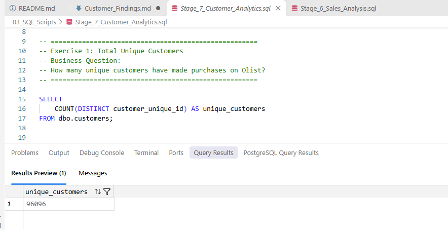
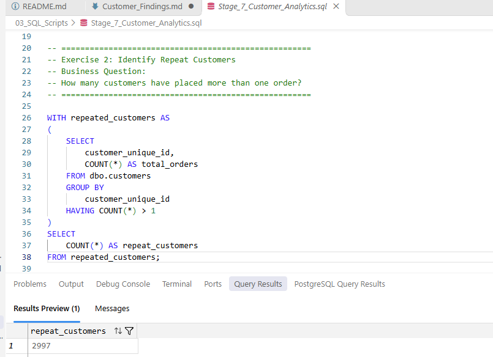
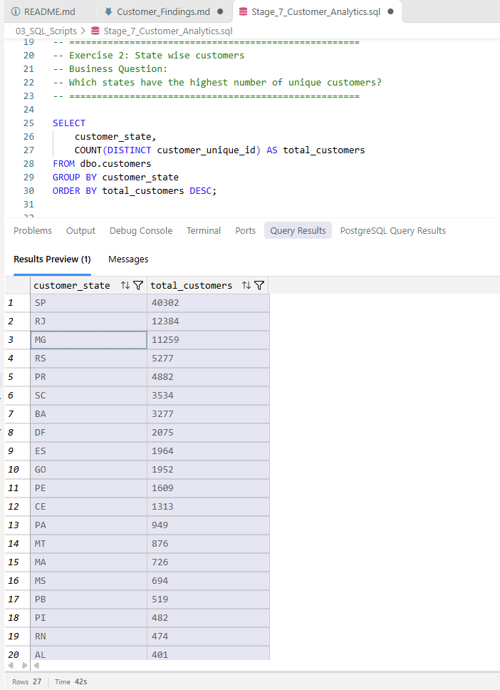
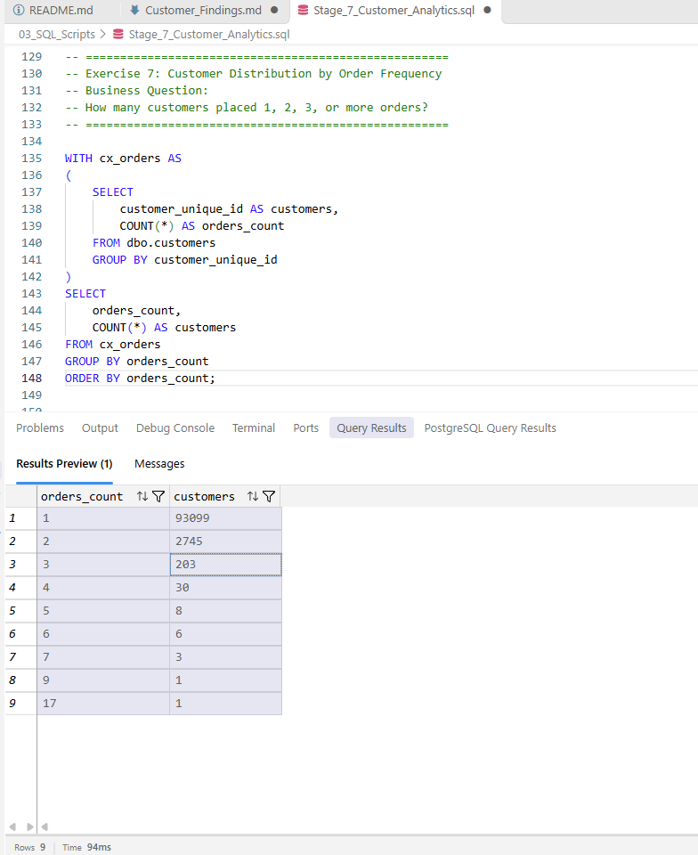

# Customer Analysis – Findings

## 1. Total Customers

**Business Question:** How many unique customers are present in the dataset?

**SQL Result:**
- Total Unique Customers: 96,096

**Business Insight:**
- The Olist dataset contains 96,096 unique customers.
- Counting `customer_unique_id` ensures that repeat purchases by the same customer are not counted as separate customers.
- This metric provides a baseline for analysing customer retention, repeat purchases, and customer behaviour.

**Screenshot:**

## 2. Repeat Customers

**Business Question:** How many customers placed more than one order?

**SQL Result:**
- Repeat Customers: 2,997

**Business Insight:**
- A total of 2,997 unique customers placed more than one order.
- These customers represent repeat purchasing behaviour.
- Understanding repeat customers can help the business develop customer retention strategies and encourage future purchases.

**Screenshot:**

## 3. Top Customer States

**Business Question:** Which states have the highest number of customers?

**SQL Result:**

| State | Unique Customers |
|---|---:|
| SP | 40,302 |
| RJ | 12,384 |
| MG | 11,259 |
| RS | 5,277 |
| PR | 4,882 |
| SC | 3,534 |
| BA | 3,277 |
| DF | 2,075 |
| ES | 1,964 |
| GO | 1,952 |

**Business Insight:**
- São Paulo (SP) has the highest customer base with 40,302 unique customers.
- Rio de Janeiro (RJ) and Minas Gerais (MG) rank second and third.
- Customer concentration is highest in Brazil's southeastern states.
- The business can use this geographic distribution to support regional marketing, logistics planning, and customer acquisition strategies.

**Screenshot:**

## 4. Customer Order Distribution

**Business Question:** How frequently do customers place orders?

**SQL Result:**

| Number of Orders | Number of Customers |
| 1 | 93,099 |
| 2 | 2,745 |
| 3 | 203 |
| 4 | 30 |
| 5 | 8 |
| 6 | 6 |
| 7 | 3 |
| 9 | 1 |
| 17 | 1 |

**Business Insight:**
- The majority of customers (93,099) placed only one order.
- 2,745 customers placed two orders.
- Only a small number of customers made frequent repeat purchases.
- This indicates an opportunity to improve customer retention through loyalty programmes, personalised offers, and follow-up campaigns.

**Screenshot:**

