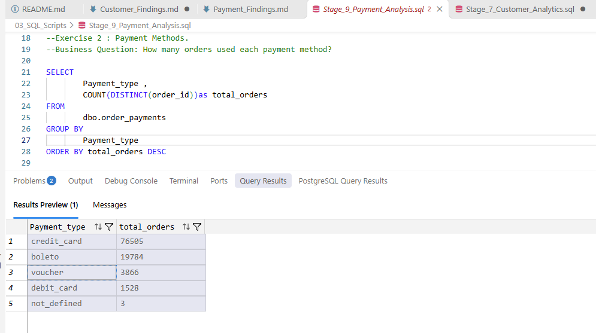
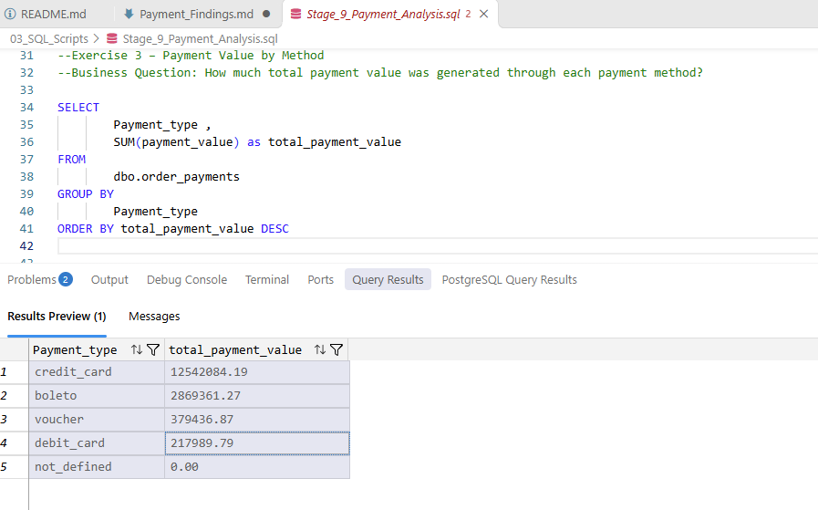
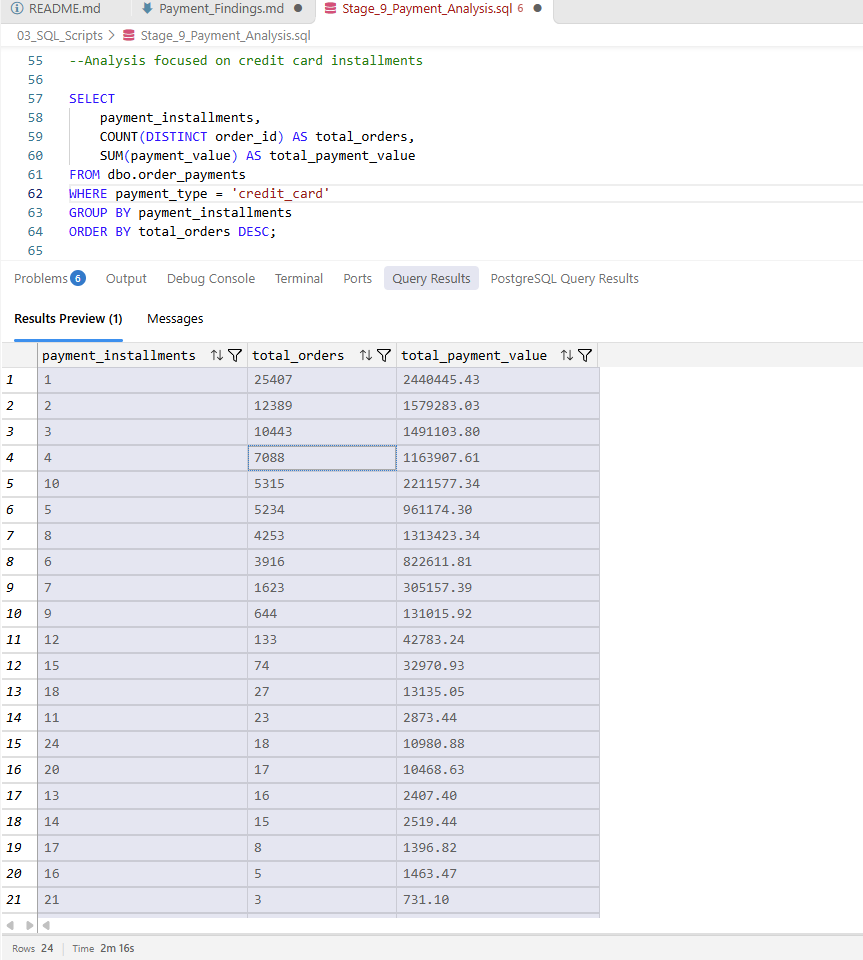
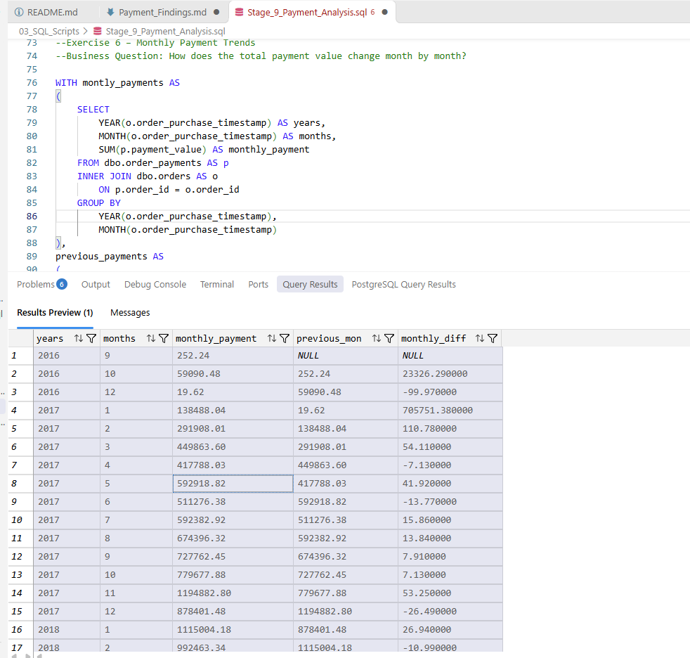
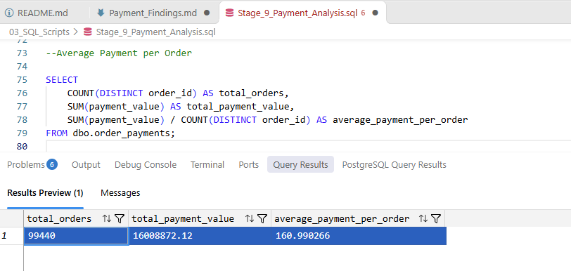

# Payment Analysis – Findings

## 1. Payment Type Distribution

**Business Question:** Which payment methods are most commonly used by customers?

**SQL Result:**

| Payment Type | Total Orders |
|---|---:|
| Credit Card | 76,505 |
| Boleto | 19,784 |
| Voucher | 3,866 |
| Debit Card | 1,528 |
| Not Defined | 3 |

**Business Insight:**
- Credit cards are the most popular payment method, accounting for the largest number of orders.
- Boleto is the second most commonly used payment method.
- Voucher and debit card usage is considerably lower.
- The business should prioritise a smooth credit card payment experience while continuing to support alternative payment methods.
- The 3 `not_defined` records may require data quality investigation.

**Screenshot:**

## 2. Payment Value by Payment Type

**Business Question:** Which payment methods contribute the highest total payment value?

**SQL Result:**

| Payment Type | Total Payment Value (R$) |
| Credit Card | 12,542,084.19 |
| Boleto | 2,869,361.27 |
| Voucher | 379,436.87 |
| Debit Card | 217,989.79 |
| Not Defined | 0.00 |

**Business Insight:**
- Credit cards contribute the highest payment value at R$12.54 million.
- Boleto is the second-largest contributor at R$2.87 million.
- Voucher and debit card payments contribute considerably less.
- The business should monitor payment-method performance and maintain reliable support for its most-used payment options.

**Screenshot:**

## 3. Credit Card Installment Distribution

**Business Question:** How are credit card orders distributed across installment options?

**SQL Result:**

| Installments | Total Orders | Payment Value (R$) |
| 1 | 25,407 | 2,440,445.43 |
| 2 | 12,389 | 1,579,283.03 |
| 3 | 10,443 | 1,491,103.80 |
| 4 | 7,088 | 1,163,907.61 |
| 5 | 5,234 | 961,174.30 |
| 6 | 3,916 | 822,611.81 |
| 7 | 1,623 | 305,157.39 |
| 8 | 4,253 | 1,313,423.34 |
| 9 | 644 | 131,015.92 |
| 10 | 5,315 | 2,211,577.34 |

**Business Insight:**
- Single-installment payments have the highest order count, with 25,407 orders.
- Ten-installment payments generate the second-highest payment value, at approximately R$2.21 million.
- Customers use a variety of installment options, including longer payment plans.
- Offering flexible installment options may help support customer purchasing decisions.

**Screenshot:**

## 4. Monthly Payment Trends (Month-over-Month Analysis)

**Business Question:** How does the total payment value change month by month?

**SQL Result:**

- Highest monthly payment value: November 2017 – R$1,194,882.80
- Second-highest: April 2018 – R$1,160,785.48
- Third-highest: March 2018 – R$1,159,652.12
- Highest positive MoM growth: November 2017 – 53.25%
- December 2017 MoM change: -26.49%

**Business Insight:**
- November 2017 recorded the highest monthly payment value in the dataset.
- Payment value increased by 53.25% in November 2017 compared with October 2017.
- December 2017 experienced a 26.49% decline compared with November.
- Payment values remained relatively strong during several months in 2018.
- The very low values in September and October 2018 suggest that the final months may contain incomplete data and should be interpreted cautiously.

**Screenshot:**

## 5. Average Payment per Order

**Business Question:** What is the average payment value per order?

**SQL Result:**
- Total Orders: 99,440
- Total Payment Value: R$16,008,872.12
- Average Payment per Order: R$160.99

**Business Insight:**
- The average payment value per order is R$160.99.
- The dataset contains 99,440 unique orders with payment records.
- This metric provides a baseline for understanding customer spending and order value.
- The business can monitor this metric over time to identify changes in customer spending behaviour.

**Screenshot:**
