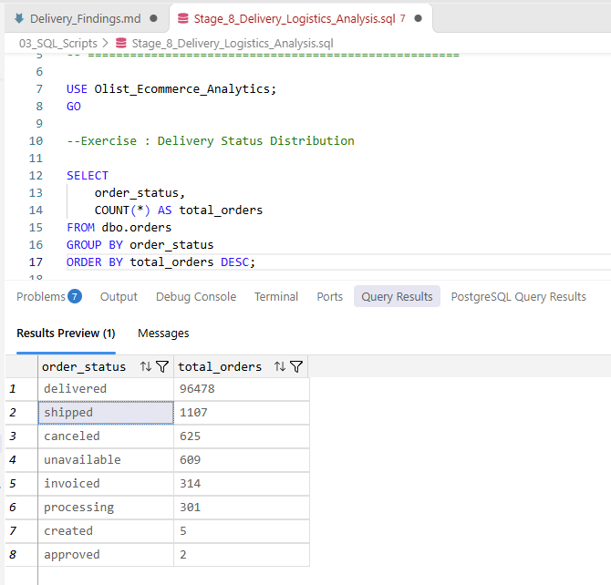
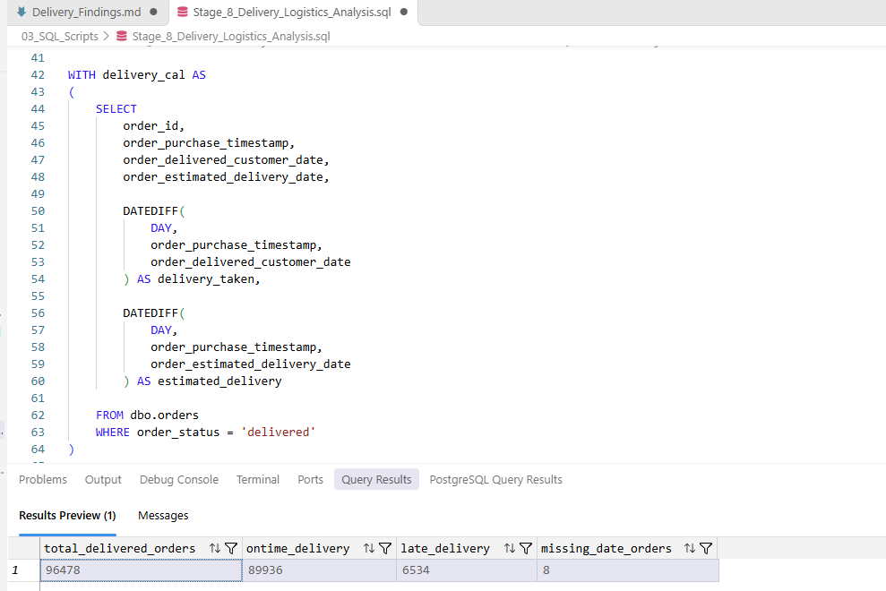
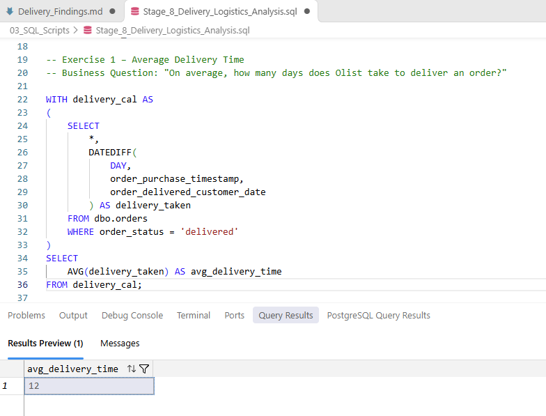
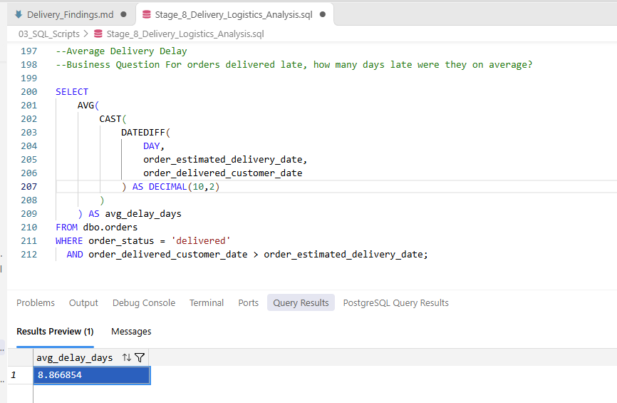
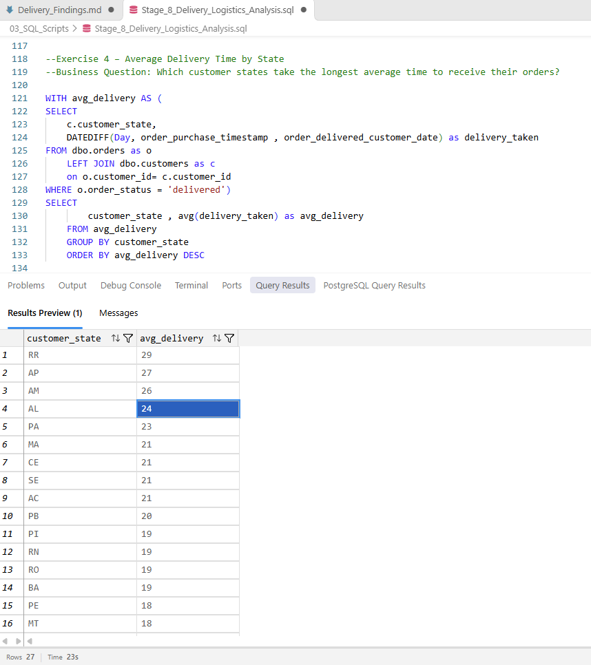

# Delivery Analysis – Findings

## 1. Delivery Status Distribution

**Business Question:** How many orders are in each order status?

**SQL Result:**

| Order Status | Total Orders |
|---|---:|
| Delivered | 96,478 |
| Shipped | 1,107 |
| Canceled | 625 |
| Unavailable | 609 |
| Invoiced | 314 |
| Processing | 301 |
| Created | 5 |
| Approved | 2 |

**Business Insight:**
- The dataset contains 96,478 delivered orders.
- Delivered orders represent the largest portion of the dataset.
- 1,107 orders are currently marked as shipped.
- Canceled and unavailable orders together account for 1,234 orders.
- The business should monitor non-delivered orders to identify fulfilment delays and operational issues.

**Screenshot:**

## 2. On-Time vs Late Delivery Performance

**Business Question:** How many delivered orders reached customers on or before the estimated delivery date?

**SQL Result:**

| Metric | Total Orders |
|---|---:|
| Total Delivered Orders | 96,478 |
| On-Time Deliveries | 89,936 |
| Late Deliveries | 6,534 |
| Missing Date Records | 8 |

**Business Insight:**
- 89,936 orders were delivered on or before the estimated delivery date.
- 6,534 orders were delivered later than expected.
- Approximately 93.22% of classifiable deliveries were on time.
- Approximately 6.77% of classifiable deliveries were late.
- Eight orders had missing date information and could not be classified.
- Improving shipment monitoring and delivery coordination can help reduce late deliveries.

**Screenshot:**

## 3. Average Delivery Time

**Business Question:** On average, how many days does Olist take to deliver an order to the customer?

**SQL Result:**
- Average Delivery Time: 12 days

**Business Insight:**
- Olist takes approximately 12 days on average to deliver an order after purchase.
- This metric provides a baseline for evaluating delivery speed.
- The business can monitor average delivery time to identify opportunities to improve logistics and fulfilment efficiency.

**Screenshot:**

## 4. Average Delivery Delay

**Business Question:** For orders delivered late, how many days late were they on average?

**SQL Result:**
- Average Delivery Delay: 8.87 days
- Late Orders: 6,534

**Business Insight:**
- Late orders were delivered approximately 8.87 days after their estimated delivery dates, on average.
- This indicates that delivery delays can significantly affect customer experience.
- The business should investigate shipment bottlenecks, carrier performance, and regional delivery issues to reduce delays.

**Screenshot:**

## 5. Average Delivery Time by State

**Business Question:** Which Brazilian states have the longest average delivery time?

**SQL Result:**

| State | Average Delivery Days |
|---|---:|
| RR | 29 |
| AP | 27 |
| AM | 26 |
| AL | 24 |
| PA | 23 |
| MA | 21 |
| CE | 21 |
| SE | 21 |
| AC | 21 |
| PB | 20 |

**Business Insight:**
- Roraima (RR) has the longest average delivery time at approximately 29 days.
- Amapá (AP) and Amazonas (AM) follow with 27 and 26 days respectively.
- São Paulo (SP) has the shortest average delivery time at approximately 8 days.
- Delivery times vary significantly across Brazilian states.
- The business should investigate regional logistics, carrier coverage, and transportation constraints in states with longer delivery times.

**Screenshot:**

## 6. On-Time Delivery Performance by Customer State

**Business Question: 
Which customer states have the highest and lowest on-time delivery percentages?**

**SQL Result:**
Highest On-Time Delivery: AM – 97.24% (145 orders)
Second Highest: RO – 97.12% (243 orders)
SP On-Time Delivery: 95.51% (40,494 orders)
RJ On-Time Delivery: 87.89% (12,350 orders)
Lowest On-Time Delivery: AL – 78.59% (397 orders)

**Business Insight:**
- AM recorded the highest on-time delivery percentage at 97.24%.
- SP maintained a 95.51% on-time delivery rate despite having the largest delivery volume.
- RJ recorded 87.89%, while AL had the lowest performance at 78.59%.
- Significant differences in delivery performance across states indicate potential regional logistics challenges.
- The business should investigate lower-performing states, focusing on carrier performance, transportation routes and regional delivery operations.

